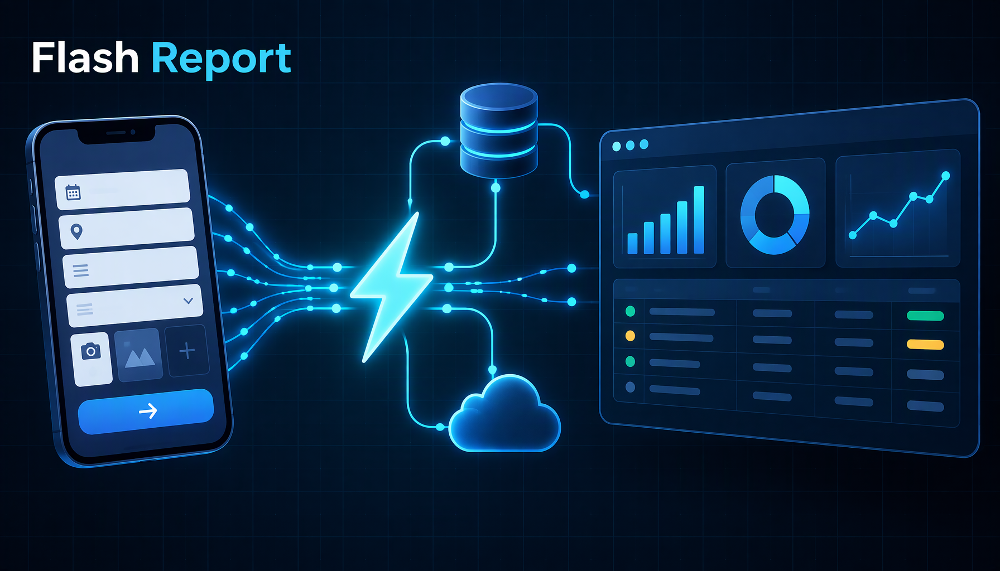

# Ops Flash Report — Web App

The React front end of the Ops Flash platform: a daily SBU sales flash report
that turns one aggregated fact table into a management-grade read — KPIs,
targets, momentum, reconciliation, scorecards and a factor-cost recovery radar.

[](https://vercel.com/new/clone?repository-url=https://github.com/your-name/ops-flash-report&directory=apps/web)




A single-page app (Vite + React 18 + TypeScript) that reads from Supabase over
PostgREST under Row Level Security. Role decides the view: **admin** gets the
full flash report plus the analysis, marketing and BIIR tabs; **officer** and
**employee** get their own SBU slice; **guest** gets a clean "no access" state.
Everything renders client-side from one report date — no server rendering, no
session glue, and the same payload powers the PDF export.

## Quick start

```bash
npm install
cp .env.example .env        # set VITE_SUPABASE_URL + VITE_SUPABASE_ANON_KEY
npm run dev                 # http://localhost:5173
```

## What's inside

- **Flash report** — day and MTD revenue, target attainment, run-rate,
  variance verdict chips and a GL reconciliation card.
- **Charts** — SBU trend, portfolio momentum, MTD ranking, forecast vs actual
  vs target; Recharts with a theme-aware token layer (`src/lib/chartTheme.ts`).
- **Advanced analysis** — ABC / Pareto, BCG-style portfolio quadrants, weekday
  seasonality, BD-division heat map, decision points.
- **BIIR radar** — four-factor cost-pressure model with per-SBU recovery plans.
- **Marketing / ROMI** — spend-vs-lead ROMI ledger and analysis layer.
- **Export** — section-scoped PDF print view for admin or employee scope.
- **Theme** — dark-first tokens with a persisted light toggle
  (`data-theme`, localStorage key `ops-flash-theme`) and full
  `prefers-reduced-motion` support.

## Scripts

| Command | Does |
| --- | --- |
| `npm run dev` | Vite dev server |
| `npm run build` | `tsc --noEmit` then production build to `dist/` |
| `npm run preview` | Serve the built bundle |
| `npm test` | Vitest unit tests (`src/test/`) |

## Auth model

Supabase email/password auth with signups disabled — accounts are invited, and
every read is filtered by RLS for the `authenticated` role. The anon key is
public by design; access is enforced in the database, not in the client.

## Design system

Colors, radii, spacing, shadows and type scale are declared once as CSS custom
properties in `src/index.css` (`--bg`, `--surface`, `--brand-2`, `--accent`,
`--r-md`, `--sp-3`, `--shadow-2`, `--series-1…8`). Chart colors read the same
palette through `chartTheme()`, so a token change restyles the app and the
plots together. Fonts: Fira Code (figures/headings) + Fira Sans (body) via one
Google Fonts link.

## Demo-data disclaimer

This is a portfolio demo. Every company, SBU, person, target, campaign row and
figure is synthetic and generated for the showcase; the schema, aggregation
logic and UI are real. No production data, credentials or endpoints are
included — `.env.example` values are placeholders.

## Deploy

Import the repo on Vercel, set the root directory to `apps/web`; the Vite
preset is auto-detected (build `npm run build`, output `dist`). Add
`VITE_SUPABASE_URL` and `VITE_SUPABASE_ANON_KEY` in Project → Environment
Variables, then point a Supabase project at `../../supabase/schema.sql`.

## License

MIT — see [PROFILE.md](../../PROFILE.md) for the full methodology write-up.
